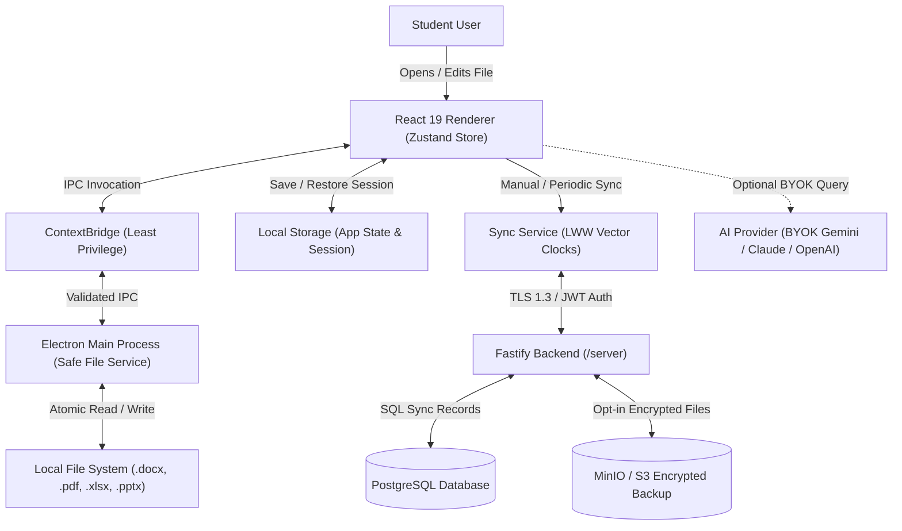

# Data Flow Diagram

### Data Flow Guarantees:
1. **Zero Unintended Uploads:** Files opened from the local drive are read and written directly via Electron Main process APIs; no document content leaves the machine without explicit opt-in.
2. **Encrypted in Transit:** All synchronization traffic requires HTTPS/TLS 1.3 with cryptographic JWT bearer tokens.
3. **Resilient Offline Operation:** When network connectivity is absent, the renderer continues reading, writing, and saving to local disk and localStorage. Convergence occurs automatically once reconnected.

